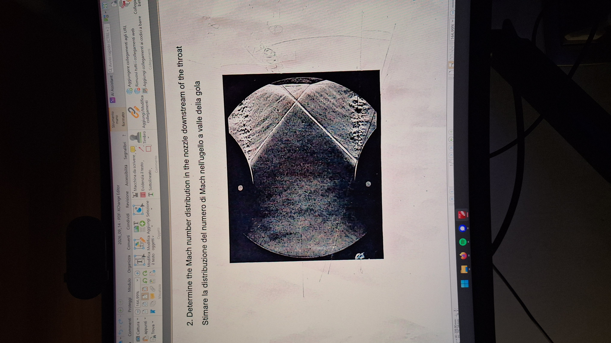

# Prova del 14/09/2026 — esercizio 2: distribuzione del numero di Mach in un ugello (schlieren)

Soluzione ufficiale del docente (prof. Favini), trascritta parola per parola da quella fornita da Alessio il 21/10/2026.
Scheda nel catalogo: [U01-E02](../catalogo.md#u01-e02). Svolgimento nel repository:
[svolgimenti/2026-09-14_E02_ugello_schlieren](../../svolgimenti/2026-09-14_E02_ugello_schlieren/svolgimento.pdf).

## Traccia

2. Determine the Mach number distribution in the nozzle downstream of the throat /
Stimare la distribuzione del numero di Mach nell'ugello a valle della gola.

Figura: visualizzazione schlieren della regione di gola di un ugello piano convergente–divergente
(foto dello schermo: [2026-09-14_E02.jpg](2026-09-14_E02.jpg)).

## Soluzione ufficiale

L’immagine schlieren mostra un flusso nell’intorno della regione di gola di un convergente-divergente. Il campo è approssimativamente simmetrico ed ai fini dell’esercizio è sufficiente considerare solo una delle due metà. La presenza di una linea sottile che parte dalla parete in corrispondenza della separazione dello strato limite indica che: a) la gola è efficace; b) che il flusso nel divergente è supersonico; c) che la pressione in uscita, regione che non compare nella figura, è tale da indurre una separazione all’interno del condotto.
Applicando la soluzione di Meyer-Sauer è possibile stimare la posizione della linea sonica, che comunque parte a parete prima della sezione di gola e arriva all’asse dopo di questa. La cosa non è richiesta, ma la conoscenza di questo fatto indica che il numero di Mach all’interno del flusso non è costante e, in particolare, è più alto a parete rispetto all’asse a parità di ascissa.
L’analisi della figura via goniometro e righello permette di ricavare: a) lo strato limite alla separazione ha una giacitura di circa 16° rispetto alla direzione della tangente alla parete; b) l’angolo dell’urto generato dalla separazione è di circa 60°, sempre rispetto alla direzione della tangente alla parete nel punto; c) il numero di Mach a monte dell’urto ricavato dalle tabelle è circa 1,68; d) all’asse questo urto arriva con una giacitura di circa 44° e riflette con una giacitura di 44° circa quindi è più una onda di Mach piuttosto che un urto obliquo, allora a questo angolo di Mach corrisponde un numero di Mach circa 1,44. 
L’ultima regione visibile vicino all’asse, prima della fine della zona visibile, può essere interpretata come un gambetto di Mach che si collega ad un punto triplo dove arriva l’onda di Mach e parte un urto obliquo forte. Dall’analisi via goniometro e righello assumendo per semplicità che a monte del punto triplo il numero di Mach sia pari a 1,44 e la direzione della corrente sia allineata con l’asse, l’urto obliquo forte ha una giacitura di circa 78° e genera una rotazione della corrente di circa 8°.
